L'« IA », c'est devenu le buzzword de la saison 2025-2026. On le colle sur tout, avec cette idée d'une boîte noire qui *comprend*. Nous, un peu moins.

C'était le moment de démystifier — pas en lisant, en construisant.

Votre mission, Jim, si vous l'acceptez : compter les points d'une partie de 7 Wonders Duel à partir d'une ou deux photos. Sans calculatrice, sans calcul mental et, si possible, avant que la bière ne tiédisse.

Mais coller un autocollant « boosté à l'IA » sur le projet juste comme argument marketing, ça aurait été trop facile. Avant d'utiliser une scie sauteuse, c'est toujours bien de savoir se servir d'une scie à main.

J'ai donc commencé avec OpenCV et des règles écrites à la main. Pas de dataset, pas de modèle entraîné par mes soins. La seule entorse était RapidOCR, un lecteur de texte pré-entraîné utilisé pour le nom des merveilles. Pour tout le reste, je voulais d'abord voir jusqu'où iraient la géométrie, les couleurs et des algorithmes de vision, tels que la détection de cercles (Hough), la comparaison de templates (*template matching*) ou le recalage à partir de points caractéristiques (ORB).

## Anatomie d'une partie de 7 Wonders Duel

Pour ceux qui n'ont jamais posé les mains sur 7 Wonders Duel, on construit chacun sa cité, avec des cartes achetées au fil de trois âges. Avant de jeter tout ça sur une table et de demander à un programme de s'y retrouver, faisons les présentations.

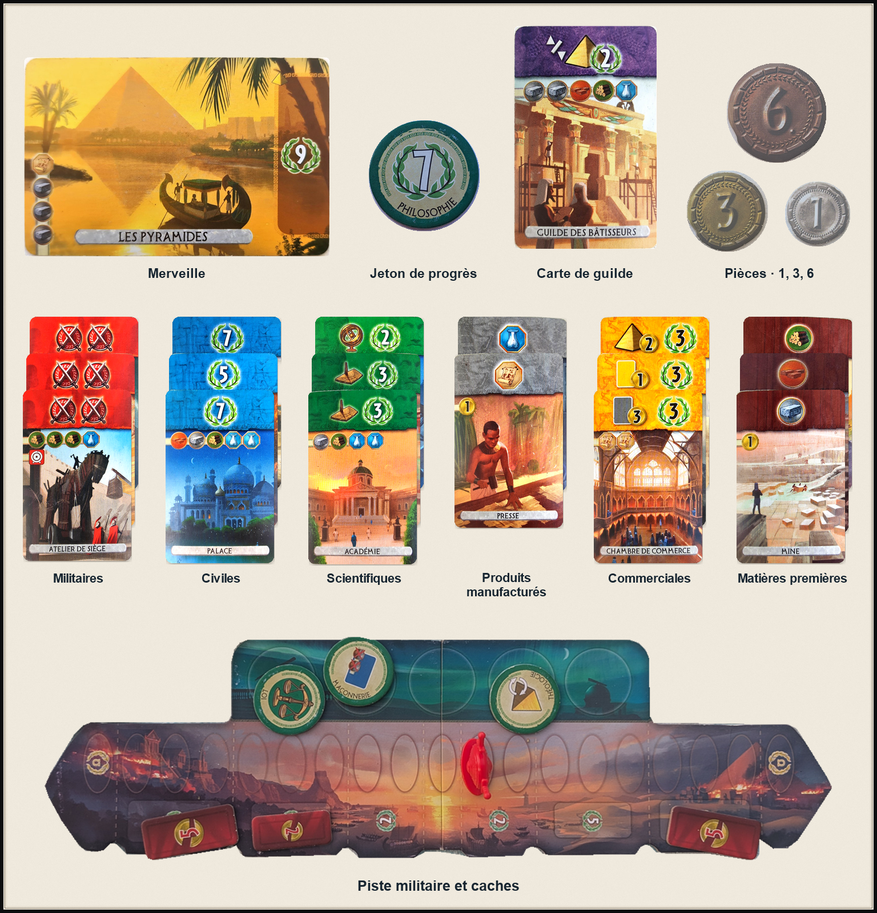

**Une merveille.** Chacun en a quatre devant lui. Ici, les Pyramides et leurs neuf points, inscrits dans une couronne de **lauriers**. Mais les avoir ne suffit pas : pour construire une merveille, on glisse une carte dessous. Il faudra donc reconnaître la merveille et vérifier si quelque chose dépasse.

**Un jeton de progrès.** Ces petits disques donnent des avantages pendant la partie, et parfois des points à la fin. Celui-ci, Philosophie, en rapporte sept. On trouve donc des lauriers sur les jetons aussi. Le programme devra éviter de compter deux fois le même cadeau.

**Une carte de guilde.** Les cartes violettes rapportent des points selon ce que les joueurs ont accumulé. Le petit symbole dans le bandeau indique quoi compter : ici, les merveilles construites. Les autres couleurs ont leurs propres rôles ; les cartes bleues, par exemple, portent directement leurs points dans des lauriers.

**Les cartes de la cité.** Les piles rouges sont militaires, les bleues civiles, les vertes scientifiques, les grises produisent des produits manufacturés, les jaunes sont commerciales et les brunes fournissent les matières premières : bois, argile et pierre. On les décale juste assez pour garder les bandeaux visibles. C'est là que se trouvent les symboles et les valeurs qui nous intéressent ; les illustrations, elles, passent en grande partie sous la carte suivante.

**Les pièces.** Le trésor contient des pièces de **1, 3 et 6**. Il faudra lire leur valeur, pas seulement compter les disques. Et comme on peut les empiler, même compter les disques mérite son petit moment de solitude.

La **piste militaire** est commune aux deux joueurs. Le pion rouge se déplace vers la cité adverse au fil des victoires militaires. Sa position permet de lire les points militaires en fin de partie.

Les rectangles rouges sont les **caches militaires** : ils font perdre des pièces à l'adversaire lorsqu'on atteint leur zone, puis sont retirés. Leurs chiffres 2 et 5 indiquent des pertes de monnaie ; les lauriers imprimés dessous indiquent des points de victoire. Même endroit, deux choses à lire. Sur la photo de la piste, un cache a déjà disparu.

Maintenant qu'on connaît les acteurs, prenons un peu de recul. Sur cette photo, on voit les deux cités et la piste militaire qui les sépare :

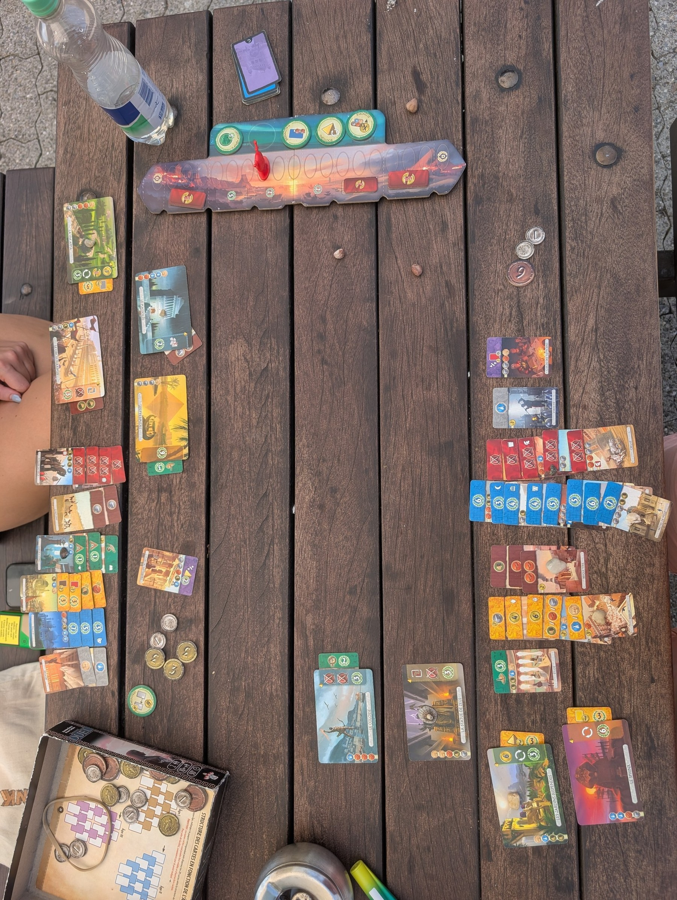

Les cartes sont généralement empilées par couleur. Pratique pour jouer, un peu moins pour les reconnaître sur une photo : leur illustration disparaît et il ne reste souvent que le bandeau du haut. Les cartes glissées sous les merveilles dépassent juste assez pour montrer qu'elles ont été construites. Le trésor et les jetons se retrouvent là où leur propriétaire leur a trouvé une place.

Voilà notre liste de courses : lire des valeurs, distinguer des symboles, compter des objets et comprendre lesquels appartiennent à qui. Le tout sur une table où chacun a surtout pensé à jouer. Personne n'avait promis de faciliter la vie du développeur.

## Premier essai : tout écrire à la main

La vision par ordinateur classique, c'est rassurant. On écrit soi-même les règles.

Un cercle assez rond et de la bonne taille ? Probablement une pièce. Une bande colorée en haut d'une carte ? On peut tenter d'en déduire sa couleur. Et, quand ça se trompe, on comprend généralement pourquoi.

Sur ma table, avec une bonne lumière, les premiers résultats étaient franchement encourageants. Au bout d'une heure, il y avait déjà assez de formes qui tombaient dans les bonnes cases pour se dire qu'on avait plié le game et qu'on pouvait retourner siroter des blue lagoons sur la plage.

Pour montrer ce que le programme doit reconnaître, revenons maintenant à un gros plan d’une seule cité : les détections sont dessinées par-dessus la photo.

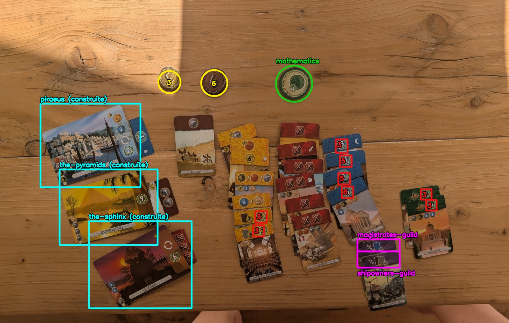

## Une image de référence, et c'était parti

Le vrai coup d'accélérateur des premières heures n'est pas venu d'un modèle entraîné. Il est venu des images de référence.

Pour essayer de reconnaître un nouvel objet, il me fallait une image propre de cet objet. C'est tout. Pas des centaines de photos à annoter, pas d'entraînement à lancer. Une référence suffisait pour tester l'idée en quelques minutes.

La version la plus directe s'appelle l'**appariement de gabarits**, ou *template matching*. Je comparais la zone photographiée à une référence — parfois les pixels, parfois la silhouette — et je gardais celle qui obtenait le meilleur score.

Encore faut-il que l'image à deviner soit orientée de la même manière que l'image de référence pour comparer un template, mais quand on fait un jeu de société sur une terrasse, on pose rarement ses cartes bien alignées sur du papier millimétré. Pareil pour la prise de vue de la photo :  une carte photographiée de biais se superposait mal à son scan. J'ai donc utilisé une technique de recalage d'images basée sur **ORB**.

Le principe de ORB, c'est de repérer des points caractéristiques sur l'image — un coin, un petit motif, une rupture de texture — puis de chercher sur l'image de référence ceux qui correspondent. S'il en trouve assez, il peut retrouver la position, l'angle et la perspective de la carte.

L'idée de départ restait la même : une image de référence, aucun entraînement. Sur mes premières photos, ça répondait assez souvent pour me donner envie d'insister. Les merveilles, surtout, offraient à ORB assez de détails pour retrouver leur contour environ neuf fois sur dix, avec une précision assez bluffante.

C'est cette réussite qui m'a convaincu que le POC tenait la route. Pour le reste, la facture arriverait un peu plus tard.

À côté de ça, la transformée de Hough cherchait les cercles et la colorimétrie triait les bannières ou tentait de lire la couleur des pièces. On n'interprétait pas encore tous les éléments du jeu, mais suffisamment pour vous coller un sourire satisfait sur le visage. Sous le capot, c'était déjà une petite brocante d'algorithmes.

Chaque outil avait une question étroite. Aucun ne prétendait comprendre la partie.

Puis j'ai posé le jeu sur une serviette de plage, dehors, au soleil couchant.

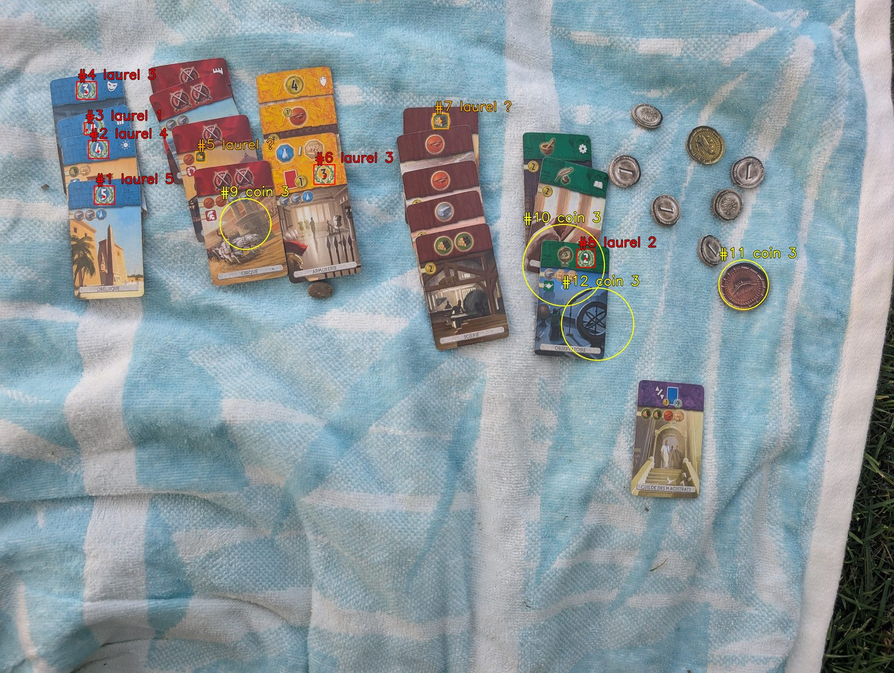

Un symbole imprimé sur une carte était promu pièce. Un jeton de progrès était compté deux fois, comme pièce et comme laurier. La seule guilde, pourtant posée bien en évidence, s'effaçait du radar.

Le programme faisait pourtant exactement ce que je lui avais demandé. Le problème, c'est que la vraie vie ne ressemble pas toujours à la table de ma terrasse.

Je pouvais ajouter une règle pour la plage, une autre pour une table sombre, puis une troisième pour les photos prises de biais. En faisant ça, j'aurais surtout obtenu un excellent détecteur de mes propres photos de test, mais incapable de généraliser aux cas que je n'avais pas encore rencontrés.

## Quand le template matching ne te fait pas gagner le match

Comme le template matching marchait super bien pour des merveilles, j'ai essayé d'en mettre partout. Évidemment.

Mais en essayant d'appliquer la même approche sur les pièces ou les symboles de guildes, j'ai vite vu que ce n'est pas parce que le seul outil qu'on a à disposition est un marteau qu'il faut considérer que tout problème est un clou.

Pour les bannières de guildes, les retrouver était relativement facile : il suffisait par colorimétrie de récupérer les bandes violettes, mais il fallait encore reconnaitre de _quelle_ guilde il s'agissait. Et difficulté supplémentaire : on ne peut compter que sur sa bannière, pas sur l'illustration de la carte, car les guildes sont empilées sur la table de jeu, contrairement aux merveilles. De fait, lui appliquer une comparaison de template avec une image de référence s'est avéré inexploitable : beaucoup trop de pixels violets communs pour trop peu de pixels différenciants - le pictogramme d'effet de la carte.

Et pour les pièces, comme elle sont circulaires, bonne chance pour les remettre droites et comparer les pixels.

## Trouver et reconnaître des pièces

À ce stade, les merveilles étaient à peu près sous contrôle et les bannières se laissaient trier par couleur. Les pièces, elles, me donnaient encore du fil à retordre.

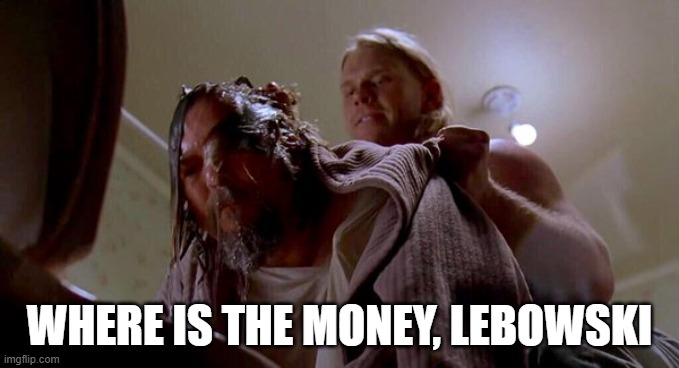

*Au moins, la première question était posée.*

Le problème en cachait en fait deux. **Où sont-elles ?** Hough parcourait la photo et proposait tous les cercles qui avaient l'air d'une pièce. **Combien valent-elles ?** Mes règles regardaient ensuite la couleur de la pièce pour choisir entre 1, 3 et 6.

Hough ratissait pourtant bien trop large. Parmi ses cercles se glissaient des symboles de cartes, des plis de tissu et d'autres imposteurs.

Lorsque l'on entraine un modèle de vision comme par exemple YOLO, le prérequis est d'avoir des centaines de photos à partir desquelles apprendre. C'est ça qu'on appelle l'entrainement. À ce stade, je n'avais que quelques parties photographiées, mais largement pas encore assez pour entrainer un détecteur YOLO. En revanche, Hough avait déjà produit des centaines de cercles que je pouvais étiqueter « pièce » ou « intrus ». C'était suffisant pour entraîner un filtre beaucoup plus léger : une petite [forêt d'arbres décisionnels](https://fr.wikipedia.org/wiki/For%C3%AAt_d%27arbres_d%C3%A9cisionnels).

Le principe: chaque arbre pose une suite de petites questions apprises : la couleur ressemble-t-elle à du métal imprimé sur du carton ? Le disque est-il texturé ? Sa taille est-elle cohérente avec les autres cercles ? Leurs votes donnaient une probabilité que le candidat soit une vraie pièce. Si la confiance était en dessous de 20 %, on l'écarte.

La forêt ne trouvait pas de nouvelles pièces et ne lisait pas encore leur valeur. Elle faisait seulement le tri dans ce que Hough lui donnait. Sur une photo extérieure particulièrement chargée, les faux positifs sont passés de **22 à 1**.

Ça avançait sur le « où ». Pour le « combien », je dépendais toujours de la colorimétrie. Sous une lumière chaude, une pièce argentée pouvait prendre des airs de pièce dorée. Cette lecture plafonnait à **71 %** de succès.

J'ai d'abord essayé de fabriquer un petit réseau maison, baptisé `TinyNet` : trois couches de convolution, autrement dit trois étages de filtres qui cherchent des motifs dans l'image, puis une réponse parmi 1, 3 et 6. Tous ses paramètres partaient au hasard. C'est cela, entraîner un modèle *from scratch*.

Sauf qu'avec mes **111 vignettes de pièces**, issues de cinq parties, je lui demandais d'apprendre à voir et à lire la monnaie en même temps. Il apprenait mes exemples par cœur, mais se débrouillait beaucoup moins bien devant une nouvelle partie : **47 %** de bonnes réponses. Même ma règle sur la couleur faisait mieux. On allait peut-être éviter de réinventer l'œil humain avec une centaine de bouts de carton.

Le *transfer learning* prend le problème dans l'autre sens. Ce n'est pas un type de réseau, mais une manière de l'entraîner : on reprend un réseau qui a déjà appris à voir sur un grand corpus d'images, puis on l'adapte à une nouvelle tâche.

L'analogie qui marche pour moi, c'est l'arrivée d'un nouveau collègue. Pour mémoriser son nom, ton cerveau n'a pas besoin de réapprendre ce qu'est un nez, une bouche ou une paire d'yeux. Il sait déjà reconnaître un visage. Il part donc avec un peu d'avance sur quelqu'un qui devrait découvrir en même temps à quoi ressemble un visage.

Dans mon cas, le réseau s'appelle ResNet18. ResNet18, c'est l'architecture ; le *transfer learning*, la manière dont je l'ai réutilisée. Préentraîné sur ImageNet, son « œil » savait déjà extraire des contours, des courbes et des textures. J'ai gardé cette base et réentraîné la fin du réseau pour lui faire donner trois réponses : « pièce de 1 », « pièce de 3 » et « pièce de 6 ».

C'est un **classifieur** : son but n'est pas de retrouver une pièce sur une image complète. Pour ça, on continue à utiliser Hough. Le classifieur est là pour nous dire la valeur de la pièce: on lui donne une vignette qui contient déjà une pièce et il lit sa valeur. Son taux de bonnes réponses est monté à **91 %**.

Ça réglait la seconde moitié du problème. La première était toujours confiée à Hough.

... Jusqu'au jour où j'ai photographié une partie sur un tapis berbère, où Hough a saturé l'image de cercles. La texture du tapis donnait à Hough beaucoup trop de candidats, même avec le filtrage de la forêt d'arbres décisionnels. ResNet pouvait très bien lire une pièce ; encore fallait-il qu'on lui en donne une.

Entre-temps, j'avais accumulé assez de photos complètes et annotées pour remplacer enfin la localisation. J'ai entraîné YOLO sur des scènes où chaque pièce était entourée.

YOLO est un **détecteur** : il reçoit toute la photo et renvoie les boîtes où il pense avoir trouvé une pièce. Il répond à « où ? ». ResNet reçoit ensuite chaque boîte découpée et répond à « quoi ? ».

Sur les pièces, le schéma était maintenant simple : YOLO les trouvait, ResNet lisait leur valeur. Les règles classiques n'avaient pas toutes disparu. Elles avaient cédé deux maillons précis, là où elles ne tenaient plus.

## Quand une image de référence ne suffit plus

Les pièces bénéficiaient donc dès maintenant d'un modèle dédié pour en connaître la dénomination. Pour les merveilles, pas besoin : ORB continuait à bien faire le job grâce à leur grand format, et leur illustration riche. Reste à voir quoi utiliser pour les symboles affichés sur les bannières de cartes: lauriers de points de victoire, symboles de science, et icônes de guilde sur les cartes violettes.

Les guildes, j'en parlais tout à l'heure, peinaient cruellement sur le template matching. Dans une vraie partie, ces cartes violettes sont empilées et on ne voit souvent que leur bandeau supérieur. L'illustration n'est donc plus visible. J'ai découpé ce bandeau et je l'ai comparé aux références.

Résultat : **18 %** de bonnes réponses.

ORB avait beaucoup de matière sur l'illustration d'une merveille. Ici, la grande zone violette était identique partout et seul un petit symbole changeait dans un coin. En comparant tous les pixels, le violet écrasait le seul détail utile.

Le même déséquilibre revenait sur les lauriers : presque toute la couronne était commune aux sept valeurs. Le chiffre qui portait la réponse pesait très peu face à tout ce qui était identique.

Entre-temps, les jetons de progrès m'avaient donné une autre idée. Et si on pouvait réutiliser ce que ResNet savait déjà voir, sans rien entraîner du tout ?

J'ai repris le réseau préentraîné sur ImageNet et je lui ai coupé la tête. Enfin, sa dernière couche, celle qui choisit une réponse. À la place d'un nom d'objet, il me rendait une liste de **512 nombres**, une sorte d'empreinte de l'image. C'est ce qu'on appelle un **embedding**.

Il suffisait de conserver les empreintes de quelques jetons dont je connaissais le nom. Pour un nouveau jeton, je calculais son empreinte, je cherchais la plus proche dans cet index et je reprenais son étiquette. Notre nouveau collègue, encore lui : cette fois, on sait déjà reconnaître son visage, il reste juste à coller un nom dessus.

La comparaison de pixels plafonnait à **77 %**. Avec les empreintes, les **43 jetons du plateau** étaient tous reconnus, sur une séance laissée de côté. Aucun entraînement supplémentaire. Forcément, j'ai voulu resservir la recette aux guildes.

Et là, retour du grand rectangle violet. Les empreintes des sept bandeaux avaient des similarités entre **0,91 et 0,98**. Sur les trois vignettes photographiées de l'essai, tout le monde devenait la Guilde des Marchands. Le réseau avait appris à distinguer des objets sur ImageNet ; personne ne lui avait expliqué que, chez nous, le petit symbole dans le coin valait davantage que tout le violet autour.

Un classifieur peut justement apprendre à donner plus de poids à certains des 512 nombres et moins aux autres. Mais si aucun ne décrit le détail utile, même la meilleure pondération du monde ne le fera pas apparaître. Dans ma recette, je réentraîne donc aussi le dernier bloc visuel de ResNet18 : celui qui fabrique ces mesures à partir des formes repérées plus tôt. Les premiers blocs gardent leurs acquis ; la fin du réseau apprend ce qu'il faut regarder dans notre jeu.

L'empreinte figée avait suffi quand l'illustration entière distinguait les jetons. Pour les guildes, il fallait apprendre à regarder le détail qui changeait.

J'aurais pu isoler le symbole, corriger la rotation, gérer la perspective et inventer encore trois seuils. J'ai préféré reprendre la recette des pièces et adapter un autre ResNet18 préentraîné aux vignettes de guildes déjà cadrées.

Sur les mêmes cas, le score est passé de **18 % à 91 %**.

Restait le lecteur des lauriers. J'avais en place une approche sans IA qui comparait la silhouette du chiffre aux templates de 1 à 7. Sur sa base, j'avais donc des vignettes déjà préannotées ; il ne restait qu'à relire et corriger ses propositions avant d'entraîner un classifieur dédié. Sur un même jeu de test de 49 lauriers, la précision est passée de **67,3 % à 95,9 %**.

Avec ce score, le classifieur est devenu le lecteur principal. Le template matching avait tout de même rempli son rôle : démarrer sans dataset et préparer les données de son remplaçant. Je pouvais maintenant réutiliser la même architecture sur plusieurs objets, au lieu de maintenir un lecteur différent pour chacun.

## Et les jetons, on leur laisse la tête coupée ?

Les guildes avaient montré pourquoi un détail pouvait justifier un entraînement. Mais les jetons, avec leurs illustrations bien distinctes et leur **43 sur 43**, semblaient pouvoir se contenter de leurs empreintes. Sur d'autres tables, d'autres serviettes et même sur de la pelouse, la réponse devenait moins évidente : le fond et la lumière changeaient suffisamment l'empreinte pour brouiller la comparaison. Enrichir l'index avec des exemples de ces décors rattrapait une bonne partie des erreurs, à condition d'avoir déjà photographié le décor.

Je voulais comprendre ce qui aidait vraiment quand le décor était nouveau. Une première possibilité : garder les **512 nombres** de l'empreinte tels quels et apprendre seulement à mieux les pondérer pour choisir le jeton. Une seconde : réentraîner aussi `layer4`, le dernier bloc visuel qui fabrique ces nombres, pour qu'il apprenne à mesurer ce qui distingue nos jetons. Dans les deux cas, les premiers blocs de ResNet18 conservaient leurs acquis.

J'ai donc laissé **121 jetons sur des décors inconnus** à l'écart des exemples et comparé ces deux apprentissages à l'empreinte figée :

| Méthode | Jetons correctement identifiés sur 121 |
|---|---:|
| Empreinte figée et plus proche voisin | 99 |
| Empreinte figée et couche de décision entraînée | 112 à 114 |
| `layer4` et couche de décision entraînés | 119 |

On mesure ici uniquement l'identité : chaque lecteur doit donner un nom, sans seuil pour refuser une vignette. Apprendre à pondérer les **mêmes 512 nombres** rapportait déjà une quinzaine de bonnes réponses. Mais la couche de décision ne peut choisir que parmi les indices présents dans l'empreinte. En réentraînant `layer4`, le réseau apprenait aussi à fabriquer des indices plus utiles : le résultat est monté à **119 sur 121**, de façon stable sur trois entraînements.

Quand les exemples contenaient déjà d'autres séances sur les mêmes décors, l'écart se resserrait : **118, 120 et 121**. Le plus proche voisin se défendait donc très bien quand l'index contenait des exemples du bon environnement. L'apprentissage du réseau apportait surtout quelque chose face à l'inconnu.

Le **43 sur 43** n'était pas faux : il montrait que l'empreinte pouvait suffire quand l'illustration entière distinguait les jetons. Les guildes racontaient l'autre moitié de l'histoire : quand un petit détail porte toute la différence, il faut apprendre à le regarder. Entre les deux, la couche de décision permet déjà de mieux exploiter les indices que le réseau sait voir.

## Et si on arrêtait de nager à contre-courant ?

À ce stade, notre boîte à outils contient déjà deux outils d'IA qui ont fait leur apparition pour résoudre principalement deux problèmes très précis :

- Les textures de la table font voir des pièces à Hough là où il n'y en a pas : YOLO reprend leur localisation.
- La couleur des pièces varie avec la lumière, et les petits symboles résistent au template matching : ResNet18 reprend leur lecture.

Reste que les couleurs des bannières peuvent elles aussi beaucoup varier selon le régime d'éclairage de la partie (Soleil au zenith, avec des reflets, soleil rasant, partie à l'ombre ou en intérieur, etc.)

La solution, on l'a déjà : généraliser aux bannières - et à terme, probablement à tous les éléments de jeu - l'approche en deux étages que l'on utilise déjà pour les pièces.

- YOLO pour la localisation, avec pour priorité de rater le moins d’objets possible (un bon *rappel*)
- ResNet18 pour la classification des boîtes détectées par YOLO

Après tout, le modèle porte assez bien son nom : _allez, YOLO, on le met partout !_

Cette architecture en deux étages me donnait l'impression de nager dans le sens du courant. Elle prolongeait ce que je faisais déjà sans IA : trouver les objets, puis lire les zones découpées. YOLO pouvait lui aussi apprendre à distinguer plusieurs classes, mais mes classifieurs avaient déjà leurs données et leurs lecteurs dédiés. Autant commencer par réutiliser ce qui marchait.

Il restait à voir si la recette tenait sur autre chose que les pièces. Les lauriers se sont chargés de tester mon enthousiasme.

## Un coup tu m'vois, un coup tu m'vois pas

Sur des photos rapprochées, le modèle YOLO localisait bien les lauriers. Sur les photos d'ensemble, les mêmes lauriers devenaient difficiles à localiser. Pourtant, la photo du téléphone était nette. En zoomant dedans, moi, je voyais parfaitement le laurier et sa valeur en points.

Pour pousser le vice, j'ai pris une photographie d'ensemble qui affichait un laurier bien net, et où pourtant  YOLO ne le localisait pas. J'ai ensuite rogné l'image autour de ce laurier pour ne conserver qu'un 10e des pixels de l'image originale, et là, magie ! YOLO se met à localiser le laurier en question avec brio. Alors pourquoi le modèle y arrivait-il dans un cas et pas dans l'autre ?

Un peu de lecture, et la vérité se fait cristalline : Un modèle YOLO ne reçoit pas directement les 12 ou 48 mégapixels de la photo qu'on lui fournit. Pour localiser les objets, toute la photo doit d'abord rentrer dans un cadre de taille fixe qui dépend de la version de YOLO que l'on utilise. Et donc forcément, si la photo est trop grande, elle est redimensionnée avant d'être fournie au modèle.

Par conséquent, dans une photo trop grande, la carte était devenue minuscule après redimensionnement, et son laurier finissait sur une poignée de pixels. Sur un gros plan, le même laurier conservait beaucoup plus de détails. Il n'y avait donc pas le même nombre de pixels à analyser, même si les deux images paraissaient parfaitement nettes sur le téléphone.

... Et puis il y avait un autre problème : dans d'autres cas, même si les lauriers étaient bien détectés par YOLO, sa valeur en points pouvait être mal lue par le classifieur ResNet18. En regardant ce que recevait le classifieur, on voit que même à l'oeil, il était difficile de reconnaitre les chiffres tant ils étaient flous. Et c'est finalement évident : si la boîte de détection de YOLO est directement donnée au classifieur, celui-ci va recevoir une version downscaled de l'image originale.

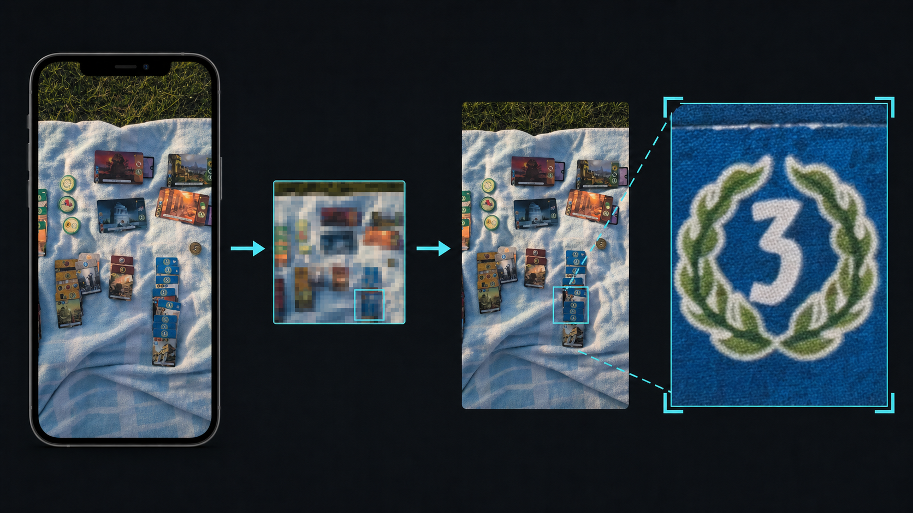

J'ai donc fait travailler les deux étages à des résolutions différentes. Le détecteur cherche les objets sur une copie réduite de la photo complète. Une fois leurs coordonnées connues, l'application retourne dans le fichier original et y redécoupe chaque zone. Le classifieur reçoit ainsi un vrai zoom, avec les détails que la réduction avait fait disparaître.

## Mes jolies cartes ne ressemblaient à aucune partie

Quand un modèle rate, le réflexe est de lui donner plus d'images. Encore faut-il qu'elles ressemblent au vrai problème.

Mon détecteur reconnaissait mal les cartes empilées. J'ai fabriqué des exemples avec des cartes bien étalées, propres et faciles à annoter. Les résultats ont empiré. Dans une vraie partie, les cartes ne sont justement jamais rangées comme ça.

J'ai refait les photos avec les cartes empilées par couleur, comme en fin de partie.

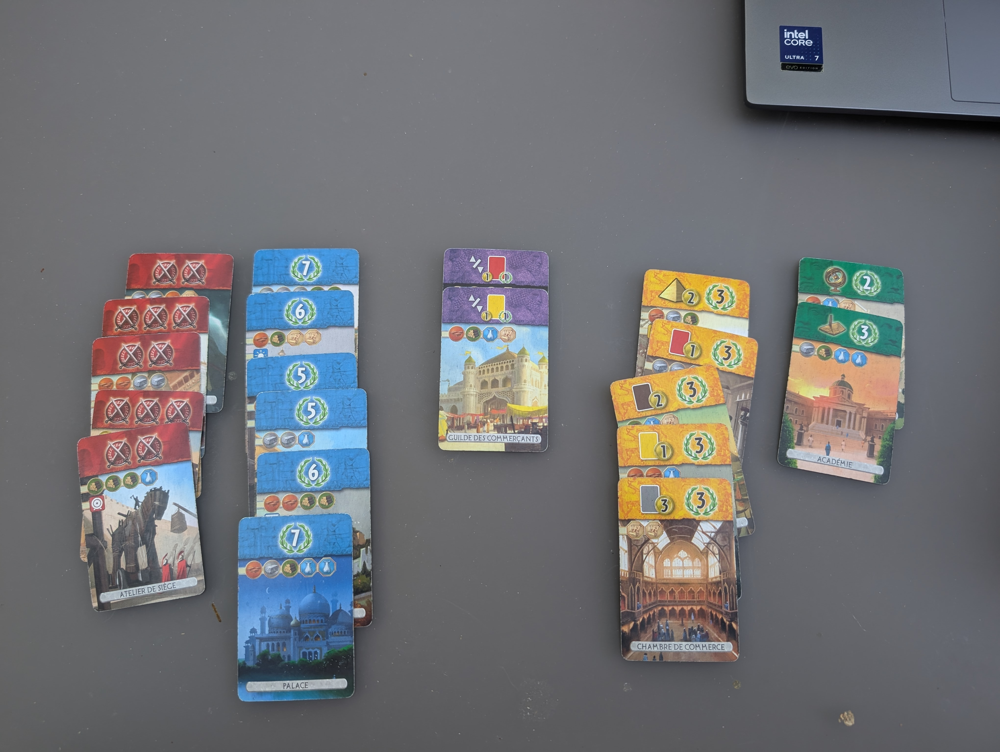

Sept photos prises dans la bonne disposition ont fait passer le repérage d'une couleur de **71 % à 99 %**.

Ce n'est pas une preuve que sept photos suffisent toujours. C'est juste qu'elles montraient enfin le problème réel. Les précédentes étaient plus jolies. Le modèle, lui, s'en fichait.

## C'est la taille qui compte !

Je pensais avoir réglé le problème de résolution en revenant découper chaque objet dans la photo originale. C'était nécessaire, mais pas suffisant.

Sur une vue d'ensemble des deux cités, certains lauriers ne faisaient plus que **48 × 65 pixels**. Le lecteur se trompait alors sur des chiffres qu'il reconnaissait très bien dans des photos plus rapprochées.

J'ai repris exactement le même recadrage et fait varier un seul facteur. L'éclaircir empirait le résultat. Renforcer la netteté aussi. En revanche, un agrandissement bicubique ×3 faisait relire le « 1 » correctement, avec **0,99** de confiance.

L'agrandissement n'avait inventé aucun détail. Il avait seulement remis les formes dans un ordre de grandeur familier pour le réseau.

J'ai donc ajouté au dataset des copies réduites à **45–70 %** de leur taille, sans retirer les originales. Le modèle apprenait désormais le même laurier de près et de loin. Sur la vue d'ensemble la plus difficile, on est passé d'environ **30/39 à 35/39** lectures correctes.

La piste militaire a posé le problème inverse. Sur certaines photos, elle occupait presque toute l'image.

Or YOLO ne peut pas dessiner une boîte de taille arbitraire. Depuis chaque point de sa grille, il prédit jusqu'où la boîte doit s'étendre vers les quatre bords, mais cette distance est bornée. Avec notre entrée de 1280 pixels, une boîte plafonnait à environ 1024 pixels de côté.

Quand la piste dépassait ce plafond, aucune prédiction ne pouvait l'englober d'un seul coup. Le détecteur faisait donc ce qu'il pouvait : plusieurs boîtes, chacune sur un morceau de piste. Les pistes tronquées et les grappes de détections étaient en fait les deux symptômes du même problème.

La solution a été de placer l'image réduite dans le cadre d'entrée, avec de la marge autour. Pas pour récupérer davantage d'information : simplement pour faire rentrer la piste dans la fenêtre de taille que YOLO savait décrire.

Mais un dézoom fixe créait aussitôt le problème opposé : les petites pistes devenaient trop petites. L'application choisit maintenant son cadrage d'après la taille des bandeaux déjà repérés dans la photo. Une vue serrée est davantage réduite ; une vue lointaine conserve plus de pixels. Sur le corpus actuel, les pistes tronquées sont passées de **11 sur 65 à 1 sur 65**, sans perdre un seul des **66 plateaux**.

La fenêtre a donc deux bords. Pour les lauriers, il fallait grossir l'objet. Pour la piste militaire, il fallait parfois lui faire de la place. La taille en pixels n'est pas un détail d'implémentation : elle fait partie de l'entrée.

Les expériences de taille, de lumière et de données synthétiques racontent toutes la même chose : une augmentation n'aide que si elle sait réellement fabriquer le défaut. C'est [le sujet d'un deuxième approfondissement](/blog/preview/e2c8a517/augmentations-images).

## Une ligne de code peut encore gagner

Introduire des modèles n'a pas rendu les règles classiques inutiles.

Avec le lecteur à empreintes, le système proposait parfois un jeton sur une photo qui n'en contenait aucun. Sur les cas examinés, les vrais dépassaient **93 %** de similarité ; les faux restaient sous **91 %**. Un seuil avait suffi à les séparer. Aucun nouvel entraînement.

Certains jetons de progrès contiennent aussi une couronne de lauriers avec un chiffre. Le lecteur avait donc de bonnes raisons de la prendre pour celle d'une carte et de compter ses points deux fois.

La correction a été géométrique : si le centre du laurier tombe dans le disque d'un jeton déjà détecté, je l'écarte. La distinction ne se faisait pas sur l'apparence, mais sur la position.

Ces deux corrections fonctionnaient parce qu'un seuil séparait proprement les bons cas des mauvais. Ce luxe n'est pas toujours disponible.

Sur une photo, le détecteur avait tracé deux cercles presque superposés sur la même pièce de 1. Le trésor valait 6 ; l'application annonçait 7. Il suffisait, en apparence, de fusionner les cercles trop proches. Sauf que le jeu autorise aussi de vraies piles de pièces.

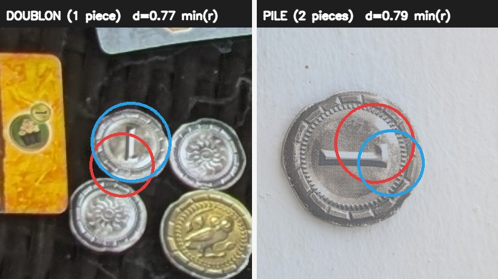

*À 0,77 contre 0,79, le seuil magique peut prendre sa journée.*

J'ai résisté à la tentation de « corriger » silencieusement. L'application marque la paire comme suspecte et demande une vérification.

Automatiser n'oblige pas à faire semblant de savoir.

## L'OCR a préparé son propre remplacement

Restait l'identité des merveilles.

Au départ, j'ai pris le *low-hanging fruit* : lire leur nom avec un OCR, autrement dit un lecteur de texte. Ça fonctionnait dès le premier jour, sans dataset ni entraînement. C'était lent et dépendant de la langue, mais j'avais une réponse. Très bien pour démarrer.

L'OCR a aussi préannoté le premier lot d'images. Je corrigeais les noms, j'agrandissais les boîtes qui ne couvraient que le texte et j'ajoutais les merveilles ratées. La solution provisoire faisait le travail et me fabriquait déjà le dataset de sa remplaçante.

Avec assez d'exemples vérifiés, j'ai entraîné YOLO à trouver les merveilles entières, puis un ResNet à reconnaître leur illustration. Sur 104 merveilles annotées à la main, l'OCR en retrouvait **80**. La voie visuelle en retrouvait **103**.

Le gain de temps justifiait déjà le remplacement. Modèles chargés sur le CPU, la voie OCR prenait environ **20 secondes par photo**. La première voie visuelle descendait à **1,4 seconde**. L'OCR n'a pas disparu : il reste un repli si le pipeline visuel ne renvoie rien.

## Apprendre à répondre « aucune »

Ce premier jeu de test ne racontait pas toute l'histoire. Sur de vraies parties, le localisateur proposait aussi des guildes, des cartes ordinaires, le plateau militaire, le livret de règles, un sachet de pièces et même un mouchoir.

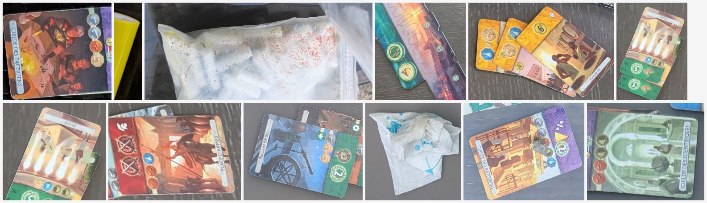

*Douze noms de merveilles pour répondre à ça. Forcément, ResNet improvisait.*

Le classifieur ne connaissait que les douze merveilles du jeu. Il devait donc choisir la moins mauvaise, même devant un objet qui n'en était pas une. La Guilde des Bâtisseurs devenait ainsi Piraeus avec une confiance de **0,9938** — et huit points fantômes partaient chez le mauvais joueur.

Relever le seuil n'a pas réglé le problème. Devant une table vide, un autre entraînement choisissait une merveille avec une confiance de **1,0000**. Hors de ce qu'il a appris, le score de confiance n'est pas un détecteur de mensonge.

J'ai donc ajouté une classe **« autre »**, nourrie avec les intrus récoltés sur de vraies photos. La fameuse treizième merveille détectée sur une image qui n'en contenait que douze n'était pas une boîte à corriger puis à oublier : c'était un négatif difficile à conserver pour l'entraînement suivant.

Sur le premier test indépendant, le nouveau modèle rejetait **63 intrus sur 64**, tout en reconnaissant un peu mieux les vraies merveilles. Le résultat important n'était pas le seuil exact : c'était d'avoir enfin posé une question à laquelle « aucune » était une réponse possible.

La même question se posait pour les jetons : les reconnaître mieux ne servirait pas à grand-chose si le classifieur en voyait partout. J'ai donc comparé l'index d'empreintes enrichi, avec son seuil de refus, à un classifieur qui connaissait les dix jetons et une classe « autre ». Cette fois, le test contenait **409 vrais jetons et 183 intrus**, avec chaque séance entièrement laissée de côté pendant son entraînement.

L'empreinte reconnaissait **365 jetons** et acceptait **2 intrus**. Le classifieur reconnaissait **404 à 407 jetons**, pour **0 à 3 intrus acceptés** selon l'entraînement et le matériel. Le gain de lecture tenait donc aussi quand on lui demandait de faire le tri.

J'ai voulu raffiner cette classe « autre » en séparant les dos de jetons, les pièces, les cartes et le décor. Ça semblait logique : pourquoi mettre dans le même sac des choses qui ne se ressemblent pas ? Avec aussi peu d'exemples par famille, le découpage faisait pourtant accepter davantage d'intrus. Ajouter des morceaux de cartes et de merveilles venus des autres lecteurs n'a pas aidé non plus. Les vrais pièges du détecteur étaient de meilleurs professeurs que mes négatifs bien choisis.

Donner au modèle le droit de répondre « aucune », c'était utile. Lui montrer ce qui risquait vraiment de le tromper l'était tout autant.

## Un contour parfait qui n'arrive pas ne sert à rien

Reconnaître une merveille ne suffit pas. Pour savoir si elle a été construite, il faut repérer la carte glissée dessous. Une fois la merveille remise à l'endroit, cette carte dépasse sur son bord droit.

C'est là que le recalage ORB du début servait encore : à partir du scan de référence, il retrouvait les quatre coins exacts de la merveille. Quand il répondait, le contour était excellent : **527 contours vérifiés, 527 corrects**. Mais il lui arrivait aussi de ne rien rendre, et chaque tentative coûtait environ **1,3 seconde par merveille** sur le téléphone.

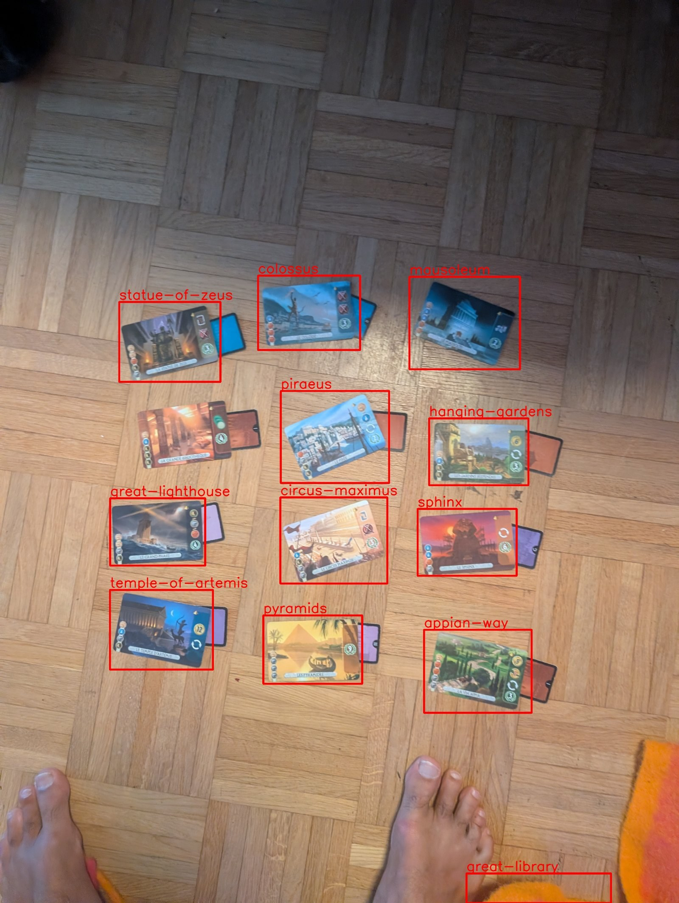

*Les noms sont bons. L'ancien recalage précis, lui, a abandonné.*

J'ai fini par remplacer ce recalage par un détecteur OBB, qui renvoie directement une boîte orientée. Son contour est un peu moins chirurgical : c'est un rectangle, pas la projection exacte d'une carte en perspective. Sur **535 annotations manuelles**, son rappel atteint **99,4 %**, contre **99,2 %** pour l'ancien détecteur à boîtes droites. Et contrairement à ORB, l'orientation arrive dans la même passe que la détection.

Il restait une ambiguïté à 180° : le rectangle était bien orienté, mais où était le haut de l'illustration ? L'orientation gênait aussi sa lecture. Présenter une même vignette au classifieur dans les quatre sens, puis garder la réponse la plus sûre, avait par exemple fait passer sa confiance de **0,49 à 0,97**. Efficace, mais cela demandait quatre lectures.

J'ai donc fusionné l'identité et l'orientation dans les réponses du classifieur : douze merveilles dans les deux sens possibles une fois le rectangle redressé, plus la classe « autre ». **24 + 1.** Une seule lecture pour savoir quelle merveille on regarde et dans quel sens la remettre.

Le chemin normal exige maintenant OBB. ORB ne subsiste que dans l'ancien repli OCR ; l'application ne bascule pas silencieusement dessus si le nouveau modèle manque.

Le détour complet — ORB, OBB, l'ambiguïté à 180° et le passage à 24 + 1 classes — est raconté dans [« ORB dessinait mieux. Je l'ai remplacé quand même. »](/blog/preview/4d7a91c2/orb-obb-merveilles). Dans le produit, l'alternative un peu moins précise sur les contours a gagné parce qu'elle répond plus souvent, beaucoup plus vite, et a permis de supprimer plusieurs étages.

## *Minority Report* réduit ses effectifs

Pour décider si une merveille est construite, l'application ne fait toujours pas confiance à un seul indice. Trois approches votent :

1. le CNN de construction regarde la bande rectifiée à droite du contour OBB ;
2. un ancien filet de sécurité sonde les quatre marges de la boîte YOLO ;
3. le détecteur cherche le bandeau de la carte qui dépasse.

Chacun a son angle mort. La sonde de boîte peut attraper la carte voisine.

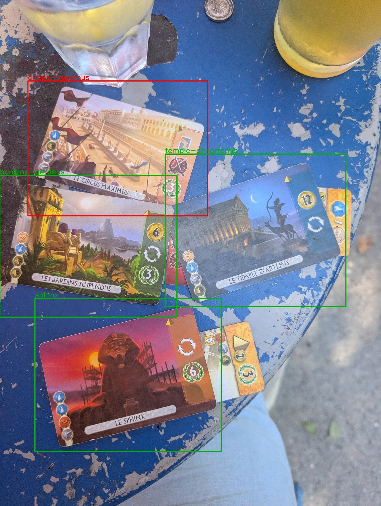

Le bandeau, lui, ne voit rien quand la carte est glissée face cachée.

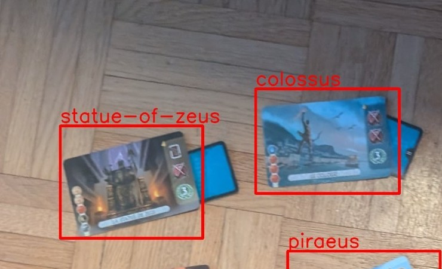

À l'époque d'ORB, ce vote compensait les moments où le recalage précis ne répondait pas. OBB a depuis changé l'équilibre : dans le chemin nominal, le premier votant ne dépend plus du succès d'ORB.

Le second votant est donc candidat à la retraite. Sur les cas connus, le CNN appliqué au bord OBB fait aussi bien sans lui. Je le garde encore parce que le test est devenu trop facile pour départager proprement les variantes, et parce qu'il reste utile si l'identité de la merveille échoue.

Le vote reste donc à trois pour le moment. Ça couvre tous les angles morts connus ; ça ne rend pas la majorité infaillible. Le prochain corpus dira si le second votant apporte encore quelque chose ou s'il ne fait que raconter l'histoire du pipeline.

## Le modèle n'a pas le droit de reconnaître la table

Pour choisir ce classifieur, je ne pouvais pas mélanger au hasard toutes les vignettes. Deux photos d'une même partie partagent la table, la lumière, le téléphone et parfois la même merveille sous un angle voisin. Le modèle aurait pu reconnaître le décor et me laisser croire qu'il avait compris la carte glissée.

J'ai donc séparé les **parties**, jamais les images. Dix-sept parties fournissaient assez de merveilles pour ce test local, même si seules sept permettaient de juger le score complet. Elles ont été réparties en six plis : à chaque entraînement, un groupe entier restait dehors. Une fois la recette validée, un dernier modèle récupérait toutes les images disponibles pour être livré dans l'application.

Le détail — provenance des annotations, validation groupée, mini-lots et ablations — est dans [« Entraîner sans se mentir : le benchmark aussi peut tricher »](/blog/preview/9b3e6f40/entrainer-sans-se-mentir).

## Les photos ratées sont les plus utiles

Il reste des cas durs : une merveille petite, à moitié cachée, mangée par un reflet. Le prochain gain viendra de photos de ce genre, pas d'un nouveau seuil choisi au hasard.

La classe « autre » est née exactement comme ça : sur une photo de douze merveilles, le détecteur en avait proposé treize. J'ai marqué l'intruse. Au prochain entraînement, elle a rejoint les exemples négatifs. L'application peut préparer l'annotation ; elle ne se corrige pas toute seule.

C'est un peu comme dans le jeu vidéo *Hades*, où le but est de s'échapper des Enfers. Quand une tentative échoue, on repart du début, mais certaines ressources récoltées pendant le *run* servent à débloquer de petites améliorations permanentes. Ici, une photo vérifiée devient l'une de ces ressources.

La prochaine version ne repartira donc pas tout à fait les mains vides.
